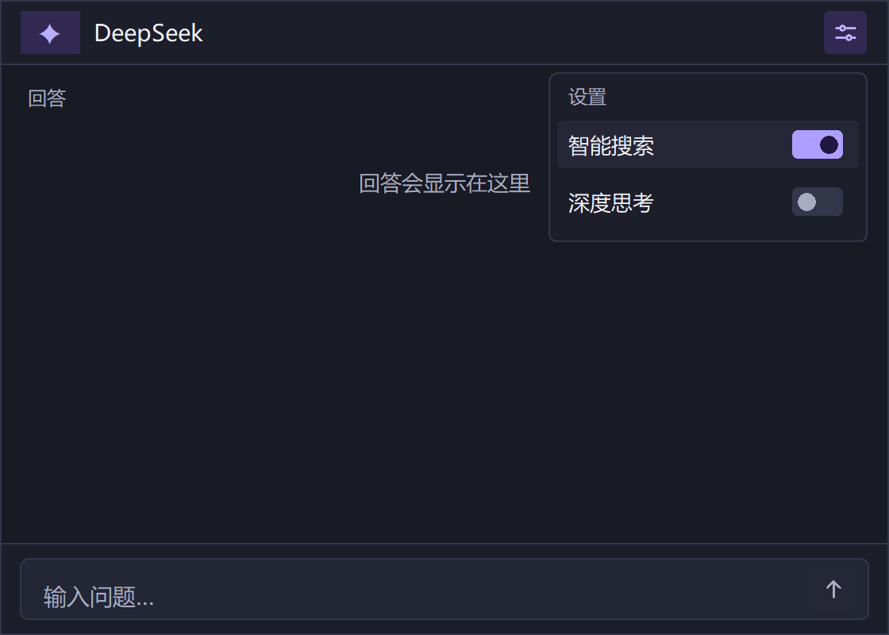

# Desktop AI

Desktop AI 是一个 Windows 托盘工具。按 `Ctrl+Shift+Y`，就能在当前应用上方打开 DeepSeek 弹窗。发出问题后，问题移到回答上方，底部输入框清空，正文随生成进度更新。点到其他窗口，弹窗会自动收起。

程序通过配套的 Microsoft Edge 扩展使用你已登录的 DeepSeek 网页账号，无需申请 API Key。

## 界面预览

以下截图来自 Windows 桌面程序，回答内容使用演示数据。

**发送前** · 在底部输入问题，按 `Enter` 或点击箭头发送。

**回答中** · 已发送的问题显示在顶部，正文逐步出现。点击底部的方块可以停止生成。

**回答完成** · Markdown 表格、标题和粗体直接渲染。可以拖选一段文字复制，也可以复制整份回答。

查看设置面板

搜索与思考开关集中在右上角。智能搜索默认开启，深度思考默认关闭。

## 下载与首次连接

需要 **Windows 10 或 11（x64）**、Microsoft Edge，以及可以登录的 DeepSeek 网页账号。

1. 在发布页的 **Assets** 中下载 `desktop-ai-v0.1.0-windows-x64.zip`，完整解压到常用目录。[打开下载页](https://github.com/aweicjnb/desktop-ai/releases/tag/v0.1.0)
2. 打开解压后的 `DesktopAI` 文件夹，双击 `Start.cmd`。便携包自带 Python 和 Tk，直接启动即可。
3. 在平时登录 DeepSeek 的 **Edge 用户配置**里访问 `edge://extensions/`。打开「开发人员模式」，点击「加载解压缩的扩展」，选择刚解压出的 `DesktopAI/edge-extension` 文件夹。
4. 回到桌面弹窗，点击「复制连接码」。在打开的扩展连接页粘贴连接码，再点「连接」。如果连接页没有打开，可以从 Edge 工具栏的扩展菜单打开 **Desktop AI · DeepSeek**。
5. 等待桌面弹窗里的「等待 Edge 连接」提示消失。输入第一个问题试用，扩展会在 Edge 中自动打开专用的 DeepSeek 标签页。

日常使用时保持桌面程序和 Edge 运行。配对信息会保存在当前 Edge 用户配置中，通常只需连接一次。

## 日常使用

| 操作 | 用法 |
| --- | --- |
| 打开弹窗 | `Ctrl+Shift+Y`，也可以双击 Windows 通知区域里的 Desktop AI 图标 |
| 发送与换行 | `Enter` 发送，`Shift+Enter` 换行 |
| 收起弹窗 | 点击其他窗口或按 `Esc`。再次打开可以继续看当前回答或编辑草稿 |
| 移动与调整大小 | 拖动顶栏移动，拖动窗口边缘或角落改变大小。本次运行中再次打开会保留尺寸 |
| 停止回答 | 点击输入区右侧的方块 |
| 复制内容 | 鼠标拖选回答中的文字，再按 `Ctrl+C`。点击回答区的「复制」时，有选区会复制选区，空选区会复制整份回答 |
| 修改搜索与思考 | 打开右上角设置，修改会用于下一条问题并在下次运行时保留 |
| 退出程序 | 右键通知区域里的 Desktop AI 图标，选择「退出」 |

开启深度思考后，推理内容保持折叠。正文开始显示且网页返回思考内容时，可点击「查看思考」展开。Windows 浅色、深色应用主题会用于下次启动的弹窗。

### 每日会话

同一 Edge 用户配置下，当天从弹窗发出的消息会复用一个 DeepSeek 网页会话，可以直接接着问。按 Windows 本地日期计算，过了零点后第一次提问会开启新会话。已经开始生成的回答可以继续完成。

弹窗只展示当前问题和回答。需要查看之前的消息时，可以在 DeepSeek 网页端打开对应会话。

## 常见问题

**快捷键没有反应** · 先确认程序正在运行，必要时展开通知区域的隐藏图标。可以双击托盘图标打开弹窗。如果程序提示快捷键已被占用，关闭占用 `Ctrl+Shift+Y` 的程序后，从托盘退出并重新启动 Desktop AI。

**一直提示「等待 Edge 连接」** · 确认扩展已启用，Edge 使用的是安装扩展的用户配置。重新点击「复制连接码」，在该配置的扩展连接页完成配对。更换 Edge 用户配置时，在旧配置停用扩展，再到新配置安装并配对。

**DeepSeek 登录失效** · 点弹窗里的「去 Edge 登录」，用已配对的 Edge 用户配置重新登录。回到弹窗后发送恢复到输入框的问题。

**我平时用 Chrome 或其他浏览器** · 弹窗的快捷键在 Windows 中全局生效，你可以一边用 Chrome、其他浏览器或桌面应用，一边从弹窗提问。当前版本的 DeepSeek 连接由 Edge 提供，Edge 需要在后台运行并保持登录。

**网页能登录，弹窗却提示找不到输入区或超时** · 打开 Edge 中专用的 DeepSeek 标签页，查看是否有登录、验证或网页故障提示。避免在弹窗发送期间同时操作该标签页。DeepSeek 网页改版也可能影响扩展的输入识别和流式读取。

**程序提示无法启动本机连接** · `41692` 是桌面程序与扩展的本机通信端口。关闭占用该端口的进程后重新启动 Desktop AI。

## 本机数据

- 问题通过已登录的浏览器发送给 DeepSeek，网页会话记录由 DeepSeek 管理。
- 桌面程序在内存中展示当前回答和草稿。设置与配对连接码保存在当前 Windows 用户的 `%LOCALAPPDATA%\DesktopAI`。扩展在当前浏览器用户配置中保存连接码和当天会话定位信息。
- 桌面程序监听 `127.0.0.1:41692`，扩展通过连接码配对。DeepSeek 的登录凭据由 Edge 管理。

## 从源码运行

1. 克隆仓库，或下载 GitHub 提供的源码压缩包并解压。
2. 使用带 Tcl/Tk 的 Python 3。可以运行 `python -m tkinter` 检查 Tk 是否可用。此版本使用 Python 3.13 验证。
3. 双击项目根目录的 `Start.cmd` 启动，再按上面的步骤加载 `edge-extension` 并配对。

在项目目录执行 `.\Start.cmd --demo` 可以查看内置的模拟流式回答，适合在配对或登录之前试用界面。桌面程序源码在 `src`，浏览器扩展在 `edge-extension`，界面截图在 `docs/screenshots`。
