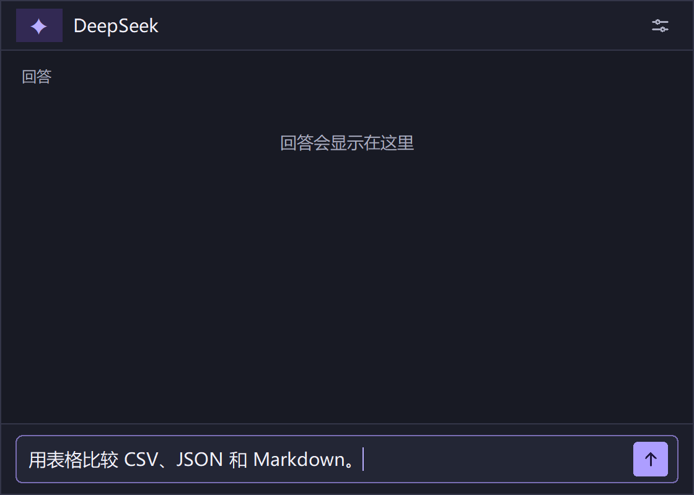
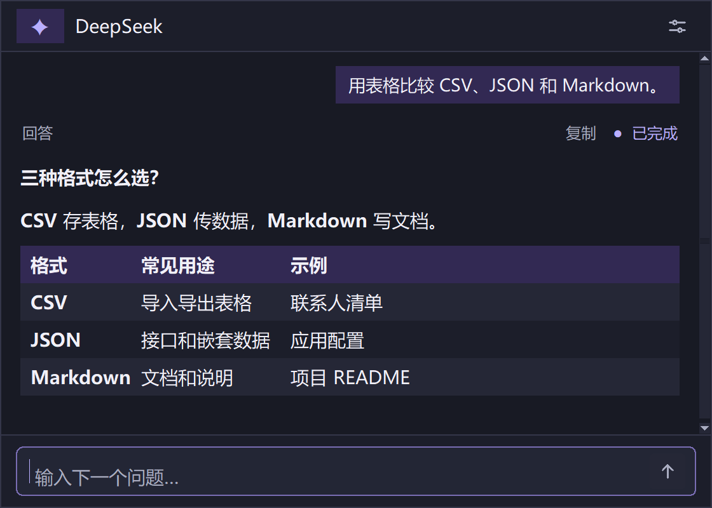

# Desktop AI

Desktop AI 是一个 Windows 托盘工具。按 `Ctrl+Shift+I`，就能在当前应用上方打开 DeepSeek 弹窗。发出问题后，问题移到回答上方，底部输入框清空，正文随生成进度更新。点到其他窗口，弹窗会自动收起。

程序使用已导入的 DeepSeek 网页登录状态，直接请求网页接口。发送、图片上传与流式回复由桌面程序完成。当天会话与日期保存在本机。

## 界面预览

以下截图来自 Windows 桌面程序，回答内容使用演示数据。

**发送前** · 在底部输入问题，按 `Enter` 或点击箭头发送。



**回答中** · 已发送的问题显示在顶部，正文逐步出现。点击底部的方块可以停止生成。


**回答完成** · Markdown 表格、标题和粗体直接渲染。可以拖选一段文字复制，也可以复制整份回答。



<details>
<summary>查看设置面板</summary>

搜索与思考开关集中在右上角。智能搜索默认开启，深度思考默认关闭。


</details>

## 下载与首次使用

需要 **Windows 10 或 11（x64）**、Microsoft Edge，以及可以登录的 DeepSeek 网页账号。

1. 下载直连版便携包 `desktop-ai-v0.2.0-windows-x64.zip`，完整解压到常用目录。[下载 v0.2.0](https://github.com/aweicjnb/desktop-ai/releases/download/v0.2.0/desktop-ai-v0.2.0-windows-x64.zip)
2. 打开解压后的 `DesktopAI` 文件夹，双击 `Start.cmd`。便携包自带 Python 和 Tk，直接启动即可。
3. 首次启动会显示「连接 DeepSeek」。选择你准备登录的 Edge 用户配置，点击「登录 DeepSeek」。
4. 在打开的网页里登录自己的账号，再按 `Ctrl+Shift+I` 回到桌面弹窗。
5. 点击「导入登录」。程序会验证登录、自动创建当天会话，并切换到提问界面。已经在该用户配置中登录的用户，可以直接点击「导入登录」。

完成导入后，日常提问由桌面程序直连 DeepSeek。登录数据通过 Windows DPAPI 加密，保存在当前用户的 `%LOCALAPPDATA%\DesktopAI\web-account.bin`。

托盘菜单中的「连接或切换账号」可以重新选择 Edge 用户配置。导入相同登录状态会复用已保存的会话，导入其他账号会创建新会话。「打开当前会话」可以查看网页记录。

## 日常使用

| 操作 | 用法 |
| --- | --- |
| 打开弹窗 | `Ctrl+Shift+I`，弹窗出现在鼠标所在屏幕。也可以双击 Windows 通知区域里的 Desktop AI 图标 |
| 发送与换行 | `Enter` 发送，`Shift+Enter` 换行 |
| 粘贴图片 | 复制截图、图片内容或一个 PNG 文件，在输入框按 `Ctrl+V`。可补充说明或直接发送，点「移除」可去掉图片 |
| 收起弹窗 | 点击其他窗口或按 `Esc`。再次打开可以继续看当前回答或编辑草稿 |
| 移动与调整大小 | 拖动顶栏移动，拖动窗口边缘或角落改变大小。本次运行中再次打开会保留尺寸 |
| 停止回答 | 点击输入区右侧的方块 |
| 复制内容 | 鼠标拖选回答中的文字，再按 `Ctrl+C`。点击回答区的「复制」时，有选区会复制选区，空选区会复制整份回答 |
| 修改搜索与思考 | 打开右上角设置，修改会用于下一条问题并在下次运行时保留 |
| 退出程序 | 右键通知区域里的 Desktop AI 图标，选择「退出」 |

开启深度思考后，推理内容保持折叠。正文开始显示且网页返回思考内容时，可点击「查看思考」展开。Windows 浅色、深色应用主题会用于下次启动的弹窗。

每条消息可带一张 PNG，最大 8 MiB。图片在点击发送后上传，等待 DeepSeek 完成图片处理，再将附件编号随问题一起发送。图片消息会暂时关闭智能搜索，之后的文字消息按原设置发送。

### 每日会话

按电脑本地日期计算，跨过凌晨 0 点后，第一次提问会自动创建并保存新会话，当天持续复用。重启或从休眠恢复后，也会在提问时检查日期。零点前已经开始的回答会继续完成。每次发送前读取当前会话的最新消息位置，以接续已有上下文。

弹窗只展示当前问题和回答。需要查看之前的消息时，可以在 DeepSeek 网页端打开对应会话。

## 常见问题

**快捷键没有反应** · 先确认程序正在运行，必要时展开通知区域的隐藏图标。可以双击托盘图标打开弹窗。如果程序提示快捷键已被占用，关闭占用 `Ctrl+Shift+I` 的程序后，从托盘退出并重新启动 Desktop AI。

**提示所选用户配置尚未登录** · 在引导页选择正确的 Edge 用户配置，点击「登录 DeepSeek」。完成登录后回到弹窗，点击「导入登录」。

**DeepSeek 登录失效** · 点弹窗里的「去 Edge 登录」，完成登录后点击「重新读取登录」。在引导页点击「导入登录」，再发送恢复到输入框的问题。

**我平时用 Chrome 或其他浏览器** · 弹窗的快捷键在 Windows 中全局生效，你可以一边用其他浏览器或桌面应用，一边从弹窗提问。导入网页登录后，问题直接通过桌面程序发送。

**连接超时或网页要求验证** · 网络恢复后可以重试。需要登录或验证时，打开当前会话完成后重新读取登录状态。网页接口发生变化时，需要更新桌面程序。

**发送后卡住或没有回答** · 在资源管理器地址栏输入 `%LOCALAPPDATA%\DesktopAI`，打开 `diagnostics.log`。用 `request=` 后的编号串起同一次请求。`web.request_started` 表示已开始直连，`web.stream_started` 表示接口已返回回复流，`web.error` 记录错误类型，`desktop.complete` 表示弹窗已处理完成事件。`elapsed_ms` 是从弹窗发送起计算的耗时。

## 本机数据

- 桌面程序使用已导入的网页登录状态向 DeepSeek 发送请求，网页会话记录由 DeepSeek 管理。
- 桌面程序在内存中展示当前回答和草稿。设置与加密后的登录、会话信息保存在当前 Windows 用户的 `%LOCALAPPDATA%\DesktopAI`。
- 诊断日志写入本机，每个文件最多约 512 KiB，保留两份轮转备份。日志记录流程阶段和错误类型，问题正文、回答、连接码、登录凭据和会话链接均不写入。

## 从源码运行

1. 克隆仓库，或下载 GitHub 提供的源码压缩包并解压。
2. 使用带 Tcl/Tk 的 Python 3。可以运行 `python -m tkinter` 检查 Tk 是否可用。此版本使用 Python 3.13 验证。
3. 双击项目根目录的 `Start.cmd`，按首次使用引导导入自己的网页登录。

在项目目录执行 `.\Start.cmd --demo` 可以查看内置的模拟流式回答。桌面程序源码在 `src`，界面截图在 `docs/screenshots`。

## 构建便携包

使用包含 Tcl/Tk 的 Python 3.13.15 x64，并准备 Python.org 提供的同版本 embeddable x64 ZIP。构建脚本校验该 ZIP 的 SHA-256，随后将当前源码、运行时与界面资源打包到 `dist`。

```powershell
python scripts/build_release.py --python-zip C:/Downloads/python-3.13.15-embed-amd64.zip
```

便携包包含 Python、Tcl/Tk、Wasmtime 和本程序使用的库。相关许可位于 `runtime` 和 `src/_vendor`。
