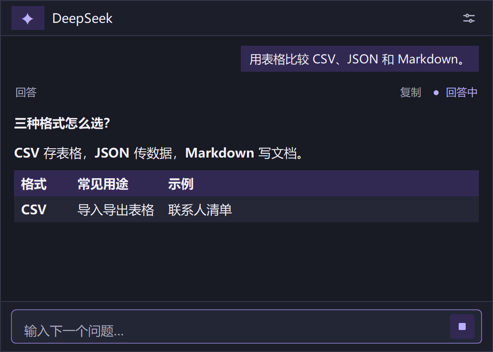

# Desktop AI

Desktop AI 是一个 Windows 托盘工具。按 `Ctrl+Shift+I`，就能在当前应用上方打开 AI 弹窗。发出问题后，问题移到回答上方，底部输入框清空，正文随生成进度更新。默认点到其他窗口会自动收起，也可以用图钉固定在指定屏幕。

程序使用已导入的 DeepSeek 网页登录状态，直接请求网页接口。发送、图片上传与流式回复由桌面程序完成。当天会话与日期保存在本机。

当前源码支持 **ChatGPT 网页直连**，通过设置顶部的 ChatGPT / DeepSeek 切换，复用自己的 Chrome 网页会话。已完成真实弹窗提问、搜索、同会话追问、停止和图片发送验收。GitHub 上原有 v0.2.0 下载包只包含 DeepSeek。

## 界面预览

以下截图来自早期 DeepSeek 界面，回答内容使用演示数据。当前版本的顶栏已新增模型入口、图钉和全屏按钮，设置也已整合为同一页面。

**发送前** · 在底部输入问题，按 `Enter` 或点击箭头发送。


**回答中** · 已发送的问题显示在顶部，正文逐步出现。点击底部的方块可以停止生成。



**回答完成** · Markdown 表格、标题和粗体直接渲染。可以拖选一段文字复制，也可以复制整份回答。


<details>
<summary>查看设置面板</summary>

搜索与思考开关集中在右上角。智能搜索默认开启，深度思考默认关闭。


</details>

## 下载与首次使用

需要 **Windows 10 或 11（x64）**、Microsoft Edge，以及可以登录的 DeepSeek 网页账号。

1. 下载直连版便携包 `desktop-ai-v0.2.0-windows-x64.zip`，完整解压到常用目录。[下载 v0.2.0](https://github.com/aweicjnb/desktop-ai/releases/download/v0.2.0/desktop-ai-v0.2.0-windows-x64.zip)
2. 打开解压后的 `DesktopAI` 文件夹，双击 `Start.cmd`。便携包自带 Python 和 Tk，直接启动即可。
3. 首次启动会显示「模型与账号」。选择 DeepSeek 和你准备登录的 Edge 用户配置，点击「登录 DeepSeek」。
4. 在打开的网页里登录自己的账号，再按 `Ctrl+Shift+I` 回到桌面弹窗。
5. 点击「导入登录」。程序会验证登录、自动创建当天会话，并切换到提问界面。已经在该用户配置中登录的用户，可以直接点击「导入登录」。

完成导入后，日常提问由桌面程序直连 DeepSeek。登录数据通过 Windows DPAPI 加密，保存在当前用户的 `%LOCALAPPDATA%\DesktopAI\web-account.bin`。

点击右上角设置，或托盘菜单中的「模型与账号」，即可进入统一设置页。顶部切换 ChatGPT / DeepSeek，下方选择模型与账号；已连接的账号默认收起登录操作，点击「管理登录」可重新导入。导入相同 DeepSeek 登录状态会复用已保存的会话，导入其他账号会创建新会话。「打开网页版」可以查看 DeepSeek 的网页记录。

### 连接 ChatGPT

1. 打开右上角设置，或点击顶栏的模型名称，在设置顶部选择 ChatGPT。
2. 如果本机已有导入的网页账号，选择账号及模型，点击「应用并返回」即可。同一账号切换模型会立即使用本机已保存的连接。日常发送无需保持 Chrome 页面打开。
3. 首次导入或需要更新登录时，点击「管理登录」或在账号列表选择「导入其他账号…」，再点击「读取网页会话」。程序会在 Chrome 打开 ChatGPT 自己的会话页面。确保使用你准备接入的账号登录，复制该页面完整 JSON。
4. 按 `Ctrl+Shift+I` 回到弹窗，点击「导入剪贴板」。程序验证登录与可用模型后切换到提问界面。会话 JSON 包含登录凭据，请只导入自己的本机程序。

程序通过 HTTPS 直接连接 ChatGPT 网页接口，执行发送前的客户端校验，并读取 SSE 流式回答。使用自己的网页登录状态，不需要浏览器扩展、独立 API Key 或另一套 OAuth 授权。可用模型和额度由 ChatGPT 账号决定。模型列表来自当前账号返回的分类，不展示网页内部实验模型。

校验组件使用本机 Node.js 和 DOM 兼容运行时，发消息时短暂启动，完成或取消后退出。源码版首次连接时会下载并校验所需组件，保存在项目的 `.runtime/chatgpt`；此目录不进入 Git。也可以提前运行 `python scripts/setup_chatgpt_runtime.py`。新便携包包含这些组件，运行时不依赖系统安装 Node、npm 或 Codex。

ChatGPT 支持流式回答、PNG 图片输入和搜索引用。智能搜索默认开启。深度思考默认关闭，开启时使用当前账号返回的思考模型；推理正文不主动展示。图片通过网页的文件接口上传，上传完成后再随问题发送。

回答区也支持显示网页配图与 GPT 生成的图片，包括纯图片回答。`AsyncImage` 等图片组件会转换为图片展示，Markdown 表格继续渲染。图片在后台加载，正文可以先阅读；加载失败时可点「重试」或「查看网页」。点击图片或「查看大图」可放大查看，点击「保存图片」可保存原始文件，网页配图还提供「图片来源」入口。

生图服务返回失败说明时，回答区保留服务端原文，状态显示「生成失败」。例如服务端提示结果可能与第三方内容过于相似时，会显示对应的中文提示。此类消息不会再被误判为连接中断，也不会自动重发生成请求。

支持 PNG、JPEG、WebP 等常用格式，单张下载最多 20 MiB、最多 2000 万像素，单次回答最多展示 8 张图片。仅在内存中保留当前回答的图片，主动保存后才写入所选文件。复制回答文字时，图片位置显示为 `[图片]`。图片解码使用独立的 Pillow 运行组件，便携包已包含；源码版首次读取图片会校验并下载组件，也可提前运行 `python scripts/setup_image_runtime.py`。相关许可位于 `.runtime/images/licenses`。

ChatGPT 会话记录由网页端保存，当天持续接续同一会话；跨过电脑本地日期的零点后，下一条问题使用新会话。重启后会继续当天会话，每次发送前读取最新消息位置。设置里的「开始新会话」可以手动切换；托盘「打开网页版」可以查看当前会话。

登录数据、模型选择和会话位置通过 Windows DPAPI 加密，保存在 `%LOCALAPPDATA%\DesktopAI\chatgpt-web-accounts.bin`。访问令牌接近过期或返回登录失效时，会尝试用已保存的网页会话 Cookie 续期；确认续期失败后提示重新导入。不会将账号切换缓存中的过期 token 自动当作当前网页登录。

日志中的 `chatgpt.web_request_started`、`chatgpt.web_check_started`、`chatgpt.web_check_accepted`、`chatgpt.web_stream_started`、`chatgpt.web_complete` 分别对应连接、开始校验、校验通过、开始接收回复和完成。错误记录 HTTP 状态、阶段和代码位置，问题正文、回答、令牌、Cookie、挑战内容和校验凭据不写入日志。

`chatgpt.web_stream_finished` 记录流是否正常结束、可见消息数、图片数和服务端是否返回失败说明；`chatgpt.web_generation_failed` 表示服务端明确报告生成失败，可与网络中断区分。

ChatGPT 的多个 HTTPS 请求会复用连接，保留系统代理配置。会话同步与发送前准备并行，图片上传也可与准备步骤重叠。`chatgpt.web_http_ready` 记录各请求阶段的响应头耗时和是否复用连接；`chatgpt.web_prepared`、`chatgpt.web_stream_started`、`chatgpt.web_first_answer` 的 `elapsed_ms` 从本次提问开始累计，便于区分准备、发送和等待首字。超时或连接中断时不会自动重发问题。

当前版本会在启动 ChatGPT 连接后，后台准备一份未使用的发送校验，并在闲置时每 **8 分钟**更新。消息被服务端接受后，立即补好下一份。已准备就绪时，发送可直接取用；尚未完成时等待当前准备。每份数据只用一次，仅保留在内存中。后台刷新失败时，仍有效的备用数据可以继续使用；网络恢复后会退避重试。网页登录状态变化、服务端返回更短期限、电脑休眠或系统时间跳变时，发送前会重新检查是否可用。

接入后同一账号连续两次短问题验收，搜索保持开启，发送时等待校验均为 0 毫秒，正文首字分别约 4.5 和 4.9 秒。每次发送使用不同校验，发送后下一份自动就绪；退出时后台线程正常停止。结果见 [预生成验收记录](docs/verification/chatgpt-prefetch-2026-11-24.json)，实际速度仍取决于当时的网络、模型和搜索执行。

服务端明确用 HTTP 403 拒绝预备校验时，程序会重新准备，再用原问题提交一次；连接超时、连接中断或回复流开始后的异常不会自动重发。`chatgpt.web_check_prefetch_ready` 表示备用数据已就绪，`chatgpt.web_check_cache_taken` 中的 `waited_ms` 表示发送时等待校验的实际耗时；`chatgpt.web_check_cache_rejected` 表示备用数据遭明确拒绝。后台准备期间不在弹窗显示进度。

在接入后台预生成之前，本机短问题测试中，搜索开启时首字从旧版约 11.6 秒降至约 7.8 秒，连续追问约 6.7 秒；关闭搜索的同类测试约 5.6 秒。这些是当时网络下的少量实测，响应时间还取决于网络、模型和搜索执行，不保证固定时延。历史记录见 [延迟优化验收](docs/verification/chatgpt-latency-2026-11-24.md)。

网页接口发生变化时仍可能需要更新程序。本次验收覆盖当前版本的真实发送流程，长期闲置和网页登录的完整生命周期仍需持续观察。

## 日常使用

| 操作 | 用法 |
| --- | --- |
| 打开弹窗 | `Ctrl+Shift+I`，未固定时出现在鼠标所在屏幕，固定后出现在指定屏幕。也可以双击 Windows 通知区域里的 Desktop AI 图标 |
| 发送与换行 | `Enter` 发送，`Shift+Enter` 换行 |
| 粘贴图片 | 复制截图、图片内容或一个 PNG 文件，在输入框按 `Ctrl+V`。可补充说明或直接发送，点「移除」可去掉图片 |
| 查看与保存回答图片 | 点击图片或「查看大图」放大，按 `Esc` 关闭大图；点击「保存图片」保存原始文件 |
| 收起弹窗 | 未固定时点击其他窗口即可收起。按 `Esc` 会先关闭设置、再退出全屏，最后收起弹窗。再次打开可以继续看当前回答或编辑草稿 |
| 移动与调整大小 | 拖动顶栏移动，拖动窗口边缘或角落改变大小。本次运行中再次打开会保留尺寸 |
| 固定屏幕 | 先在需要的屏幕打开弹窗，再点击顶栏图钉固定并保持显示；再次点击取消固定。固定的屏幕、位置和尺寸会保留到下次启动 |
| 全屏与还原 | 点击顶栏全屏按钮，或双击应用名称，铺满当前屏幕；再次点击或按 `Esc` 还原。全屏不会修改正常窗口的尺寸 |
| 切换来源与模型 | 点击顶栏模型名称或设置按钮，在统一设置页选择来源、模型和账号，然后「应用并返回」 |
| 停止回答 | 点击输入区右侧的方块 |
| 复制内容 | 鼠标拖选回答中的文字，再按 `Ctrl+C`。点击回答区的「复制」时，有选区会复制选区，空选区会复制整份回答 |
| 修改搜索与思考 | 打开右上角设置，修改会用于下一条问题并在下次运行时保留 |
| 退出程序 | 右键通知区域里的 Desktop AI 图标，选择「退出」 |

开启深度思考后，推理内容保持折叠。正文开始显示且网页返回思考内容时，可点击「查看思考」展开。Windows 浅色、深色应用主题会用于下次启动的弹窗。

固定屏幕后，窗口移动与缩放会限制在该屏幕的可用区域。断开这个屏幕时，窗口会临时显示在可用屏幕；重新连接后，快捷键仍会在原先固定的屏幕唤出。不同缩放比例的屏幕之间切换时，界面按目标屏幕的 DPI 调整。

每条消息可带一张 PNG，最大 8 MiB。DeepSeek 图片在点击发送后上传，等待图片处理完成，再将附件编号随问题一起发送。DeepSeek 图片消息会暂时关闭智能搜索，之后的文字消息按原设置发送。

### 每日会话

DeepSeek 按电脑本地日期计算，跨过凌晨 0 点后，第一次提问会自动创建并保存新会话，当天持续复用。重启或从休眠恢复后，也会在提问时检查日期。零点前已经开始的回答会继续完成。每次发送前读取当前会话的最新消息位置，以接续已有上下文。

弹窗只展示当前问题和回答。需要查看之前的消息时，可以在 DeepSeek 网页端打开对应会话。

## 常见问题

**快捷键没有反应** · 先确认程序正在运行，必要时展开通知区域的隐藏图标。可以双击托盘图标打开弹窗。如果程序提示快捷键已被占用，关闭占用 `Ctrl+Shift+I` 的程序后，从托盘退出并重新启动 Desktop AI。

**提示所选用户配置尚未登录** · 在引导页选择正确的 Edge 用户配置，点击「登录 DeepSeek」。完成登录后回到弹窗，点击「导入登录」。

**DeepSeek 登录失效** · 点弹窗里的「去 Edge 登录」，完成登录后点击「重新读取登录」。在引导页点击「导入登录」，再发送恢复到输入框的问题。

**我平时用 Chrome 或其他浏览器** · 弹窗的快捷键在 Windows 中全局生效，你可以一边用其他浏览器或桌面应用，一边从弹窗提问。导入网页登录后，问题直接通过桌面程序发送。

**连接超时或网页要求验证** · 网络恢复后可以重试。需要登录或验证时，打开当前会话完成后重新读取登录状态。网页接口发生变化时，需要更新桌面程序。

**发送后卡住或没有回答** · 在资源管理器地址栏输入 `%LOCALAPPDATA%\DesktopAI`，打开 `diagnostics.log`。用 `request=` 后的编号串起同一次请求。`web.request_started` 表示已开始直连，`web.stream_started` 表示接口已返回回复流，`web.error` 记录错误类型，`desktop.complete` 表示弹窗已处理完成事件。`elapsed_ms` 是从弹窗发送起计算的耗时。

## 本机数据

- 桌面程序使用已导入的网页登录状态向 DeepSeek 发送请求，网页会话记录由 DeepSeek 管理。
- 桌面程序在内存中展示当前回答和草稿。设置与加密后的登录、会话信息保存在当前 Windows 用户的 `%LOCALAPPDATA%\DesktopAI`。
- 诊断日志写入本机，每个文件最多约 512 KiB，保留两份轮转备份。日志记录流程阶段和错误类型，问题正文、回答、连接码、登录凭据和会话链接均不写入。

## 从源码运行

1. 克隆仓库，或下载 GitHub 提供的源码压缩包并解压。
2. 使用带 Tcl/Tk 的 Python 3.13 x64。可以运行 `python -m tkinter` 检查 Tk 是否可用。当前图片解码组件匹配这一版本。
3. 双击项目根目录的 `Start.cmd`，按首次使用引导导入自己的网页登录。

在项目目录执行 `.\Start.cmd --demo` 可以查看内置的模拟流式回答。桌面程序源码在 `src`，界面截图在 `docs/screenshots`。

运行 `python scripts/test_chatgpt_web.py` 和 `python scripts/test_chatgpt.py` 可执行不使用真实账号的 Windows 回归检查，覆盖网页会话导入与续期、账号隔离、流式协议、每日会话、引用渲染和界面切换。`python scripts/test_window_layout.py` 检查固定屏幕、混合 DPI 坐标、全屏还原和设置页交互。

`python scripts/test_http_transport.py` 使用本机 HTTP/1.1 测试服务器，检查连接复用、未读正文、服务端关闭、HTTP 错误、代理凭据隔离、流式首段和取消阻塞读取。

`python scripts/test_prepared_check.py` 检查单次取用、8 分钟定时刷新、较短的服务端期限、休眠和身份变化、失败后保留有效数据、取消与退出，以及校验拒绝恢复和不重复发送。

`python scripts/test_rich_content.py` 检查图片组件、压缩流数组、纯图片完成事件、图片元数据补充、下载重定向的凭据隔离、图片解码和真实 Tk 图片展示、放大、保存、复制。运行图片测试前先执行 `python scripts/setup_image_runtime.py`。

## 构建便携包

使用包含 Tcl/Tk 的 Python 3.13.15 x64，并准备 Python.org 提供的同版本 embeddable x64 ZIP。构建脚本校验该 ZIP 的 SHA-256，先准备 ChatGPT 校验运行时，随后将当前源码、运行时与界面资源打包到 `dist`。

```powershell
python scripts/setup_chatgpt_runtime.py
python scripts/setup_image_runtime.py
python scripts/build_release.py --python-zip C:/Downloads/python-3.13.15-embed-amd64.zip
```

便携包包含 Python、Tcl/Tk、Wasmtime、Node.js、jsdom、Pillow 和本程序使用的库。相关许可位于 `runtime`、`src/_vendor`、`.runtime/chatgpt` 及 `.runtime/images/licenses`。账号和日志保存在当前 Windows 用户目录中，不进入便携包。
